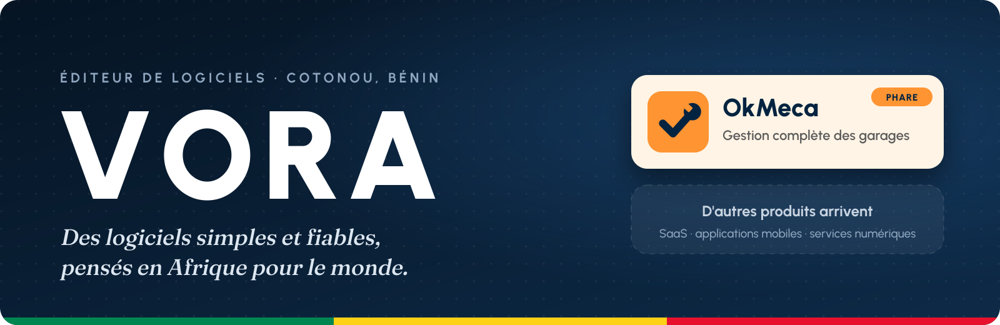
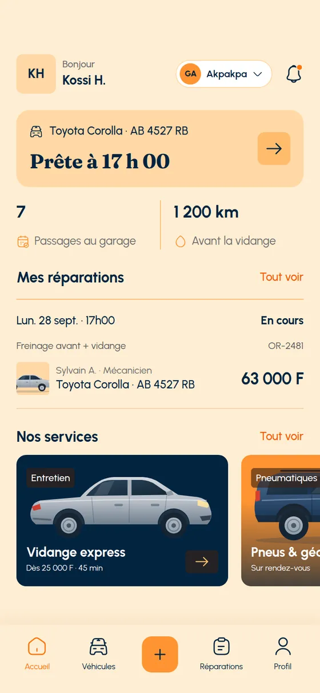
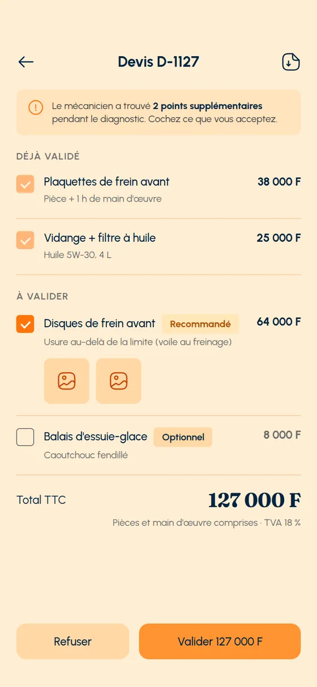
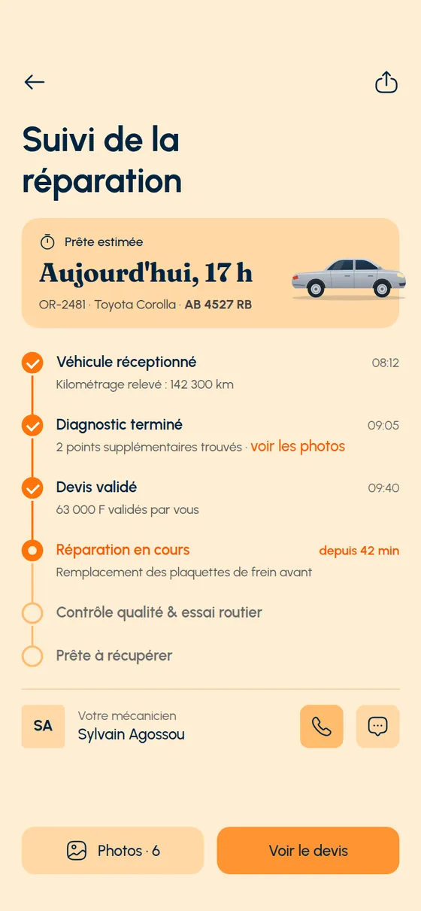
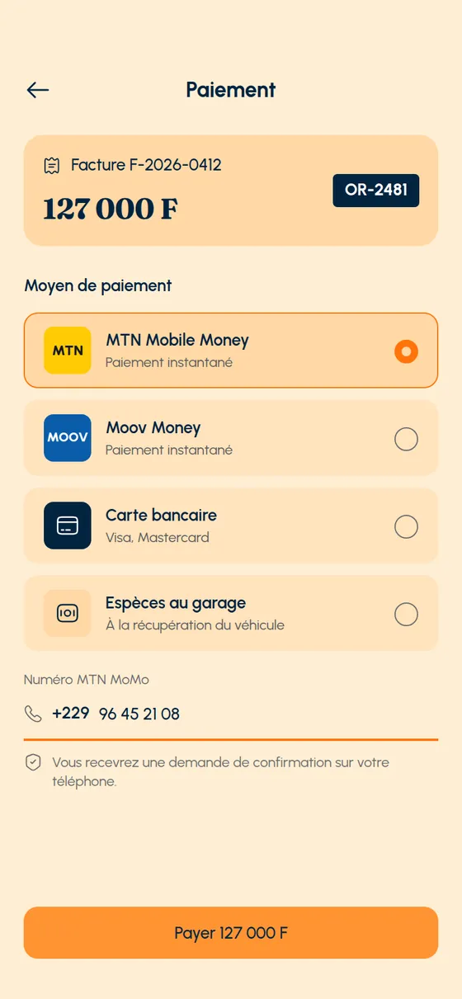
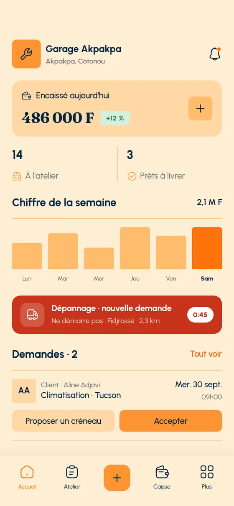
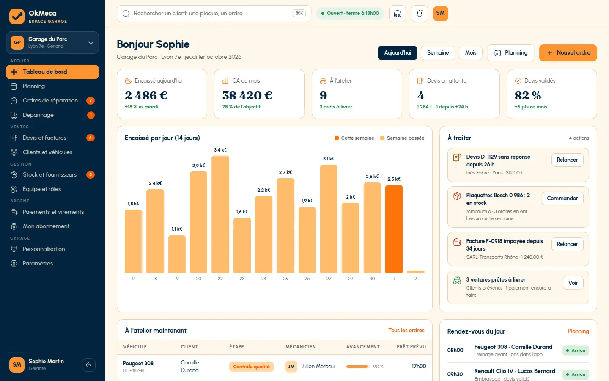

 

## 👋 Qui sommes-nous

**VORA** est un éditeur de logiciels basé à Cotonou, au Bénin. Nous concevons, développons et exploitons des
applications mobiles et des plateformes en ligne (SaaS) qui simplifient le quotidien des entreprises —
d'abord en Afrique de l'Ouest, puis partout où elles en ont besoin.

<table>
  <tr>
    <td width="33%" valign="top">
      <h3>🧩 Produits SaaS</h3>
      Des plateformes métier complètes, hébergées et maintenues par nos soins, payables en mobile money ou par carte.
    </td>
    <td width="33%" valign="top">
      <h3>📱 Applications mobiles</h3>
      Des applications iOS et Android rapides, pensées pour les réseaux et les usages locaux.
    </td>
    <td width="33%" valign="top">
      <h3>🎓 Conseil &amp; formation</h3>
      Accompagnement des entreprises dans leur passage au numérique, et formations en ligne.
    </td>
  </tr>
</table>

## 🚀 Nos produits

### OkMeca · produit phare

La plateforme qui fait tourner un garage automobile de bout en bout, pour **les clients**, **les mécaniciens**
et **les gérants** — au Bénin, dans la zone UEMOA et en France.

| Module | Ce que fait OkMeca |
|---|---|
| 🔧 **Atelier** | Rendez-vous, ordres de réparation, devis validés en ligne, pointage et tâches des mécaniciens |
| 🧾 **Facturation** | Factures et reçus PDF, factures normalisées **e-MECeF** au Bénin, caisse et rapport Z |
| 📦 **Pièces** | Stock, fournisseurs, commandes et réceptions, réservations pour l'atelier |
| 💳 **Paiements** | Mobile money **MTN** et **Moov**, carte bancaire, acomptes et paiements en plusieurs fois |
| 📍 **Clients** | Suivi de la réparation en temps réel, photos, messagerie avec le garage, carnet d'entretien |

  
  
  
  
  
    
  

> 🛠️ D'autres produits sont en préparation : SaaS, applications mobiles et services numériques.

## 💡 Notre façon de travailler

- **Simple d'abord** — chaque écran doit se comprendre sans formation.
- **Fiable** — sauvegardes chiffrées hors serveur, restauration testée automatiquement chaque mois, surveillance 24 h/24.
- **Local** — mobile money, facturation normalisée e-MECeF, français et anglais, réseaux mobiles africains.
- **Ouvert au monde** — les mêmes produits en zone UEMOA et en Europe.

## 🧰 Nos technologies

  

## 📬 Nous contacter

**[okmeca.com](https://okmeca.com)** · **[contact@okmeca.com](mailto:contact@okmeca.com)** · Cotonou, Bénin 🇧🇯

VORA · Éditeur de logiciels · RCCM RB/PNO/26 A 129562

